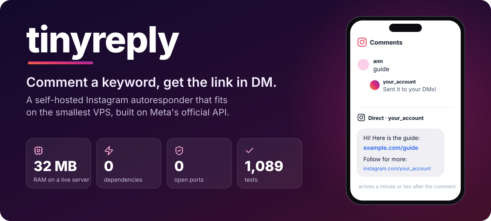
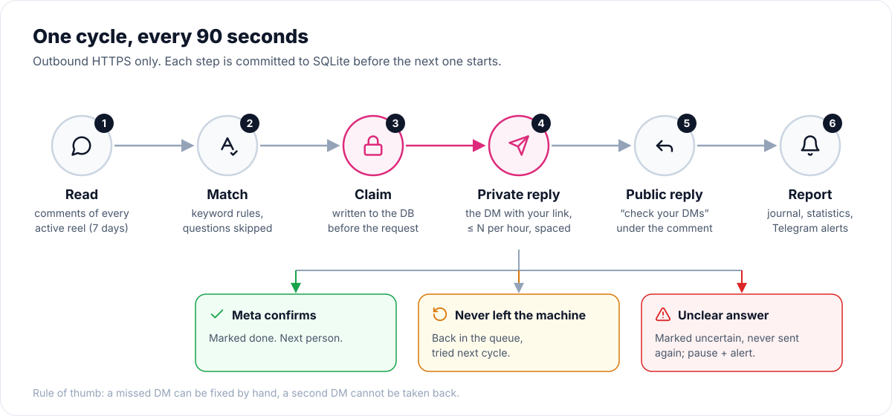
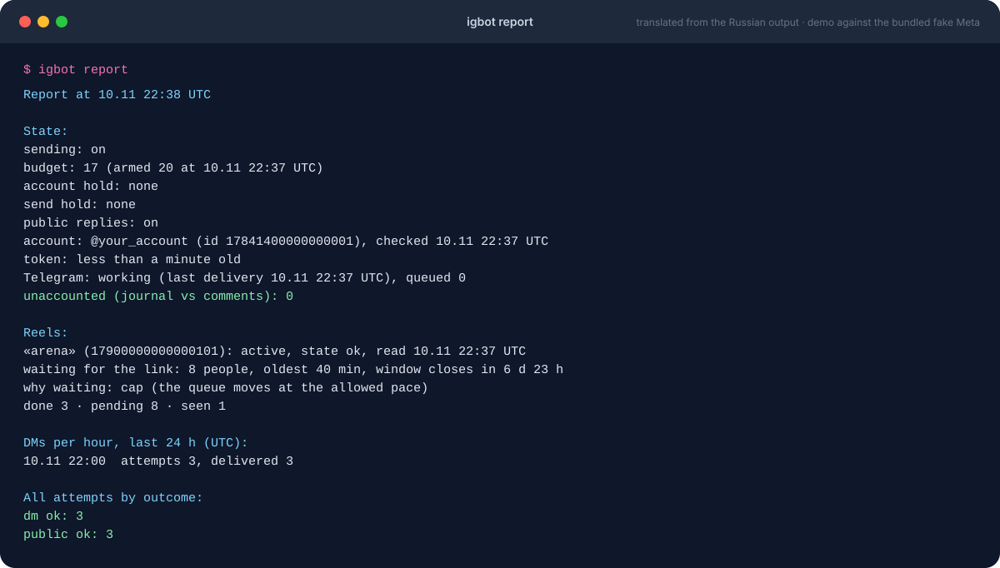
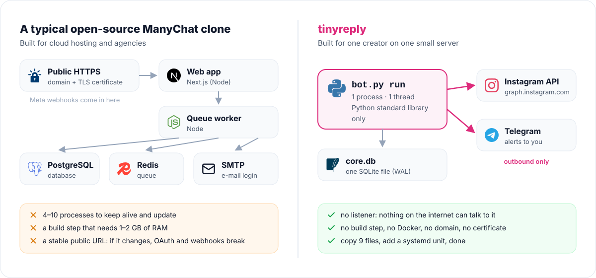
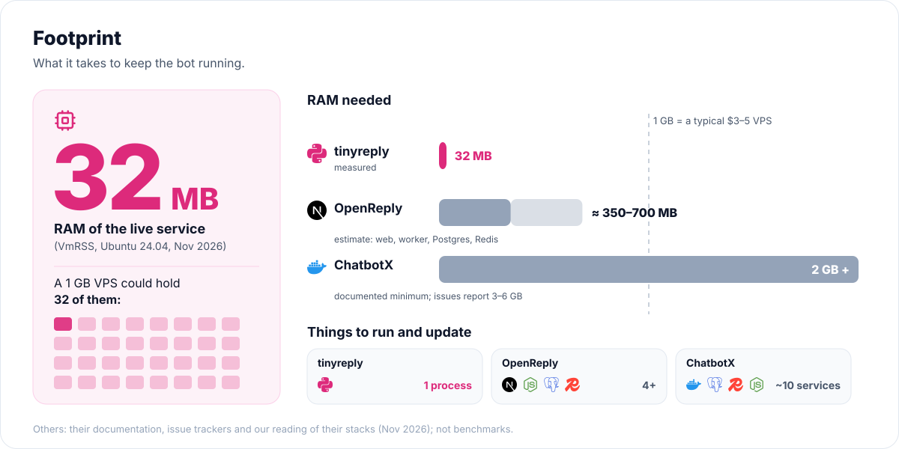

<p align="center"></p>

<p align="center">
  <a href="https://github.com/Lemelson/tinyreply/actions/workflows/tests.yml"></a>
  <a href="LICENSE"></a>
  
  
</p>

**tinyreply** is a self-hosted, ManyChat-style "comment a keyword, get the link in DM" bot for Instagram.
Someone comments `guide` under your reel, and a minute later they have a private message with your link and a
public "check your DMs" reply under their comment.

It is the opposite of the usual open-source ManyChat clone: not a platform for agencies, but **one small
program for one creator on one cheap server**. It uses only Meta's official Instagram API, and it was built
around a single promise: **nobody gets the DM twice, and nobody is silently skipped.**

- [Why tinyreply](#why-tinyreply)
- [How it works](#how-it-works)
- [Compared with the alternatives](#compared-with-the-alternatives)
- [Quick start](#quick-start)
- [Everyday commands](#everyday-commands)
- [What it does not do (yet)](#what-it-does-not-do-yet)
- [For AI agents](#for-ai-agents)
- [Keeping your secrets out of git](#keeping-your-secrets-out-of-git)

## Why tinyreply

| | |
|---|---|
| **Tiny** | One Python process, one thread, one SQLite file. **32 MB RAM** measured on a live Ubuntu server. About 3,900 lines of code. |
| **Zero dependencies** | Python 3.12 standard library only. No `pip install`, no Node, no Docker, no build step, nothing to keep patched. |
| **Zero open ports** | It polls Meta instead of waiting for webhooks. No domain, no TLS certificate, no public URL to keep stable. Runs behind NAT or next to other services. |
| **Never double-sends** | Each DM is claimed in the database *before* the request leaves. A crash, a restart or a second copy of the bot cannot send it twice (a file lock stops the second copy). |
| **Never silently loses people** | Every matched comment ends in an explicit status with a reason. The report checks that the numbers add up (`unaccounted` must be 0). When people are waiting or being lost, you get a Telegram alert, and it repeats until the problem ends. |
| **Catches up** | It reads the whole 7-day window that Meta allows for private replies. If the bot was down for a day, the backlog is served, oldest first, within your hourly limit. |
| **Understands real comments** | `Арена`, `арена!`, `ARENA`, `Aрена` (a Latin A inside a Cyrillic word), `arena`, `арееа`: all match one keyword. Case, ё/е, repeated letters, emoji, @mentions and configured typos are handled. It was checked against 1,108 real comments from a live reel: every one of them matched. |
| **Safe by default** | A new database, a config change or a code update sets the send budget to 0. Nothing goes out until you `arm` it. `disarm` is an instant emergency brake. |
| **Tested like it matters** | 790 unit tests, 299 simulator tests and named end-to-end scenarios run the real bot against a strict fake of the Meta API. The fake injects timeouts, 5xx errors, rate limits, token expiry, spam blocks and crashes in the middle of a send. |

## How it works

<p align="center"></p>

Every `poll_interval_sec` (90 s by default) the bot reads the comments of every active reel, matches them,
and sends at most `max_sends_per_hour` private replies. Meta allows **one** private reply per comment, within
7 days. If Meta's answer is ambiguous (a timeout after the request was sent, for example), the comment is marked
`uncertain`, the bot does **not** retry it, and you are told. A second DM to the same person is worse than one
missed DM that you can check by hand.

You see the state of everything with one command:

<p align="center"></p>

## Compared with the alternatives

<p align="center"></p>

<p align="center"></p>

The two most popular open-source projects in this niche, checked on 10 Nov 2026:

| | **tinyreply** | [OpenReply](https://github.com/diwenne/openreply) | [ChatbotX](https://github.com/ChatbotXIO/ChatbotX) | [chatmany](https://github.com/ryanlaiyanip-ctrl/chatmany) | ManyChat / ChatPlace (SaaS) |
|---|---|---|---|---|---|
| Runs on | any Linux box with Python 3.12 | Node ≥ 20 + Postgres + Redis + SMTP | ~10 services, TimescaleDB, S3 | Cloudflare Workers + D1 | their cloud |
| RAM | **32 MB** (measured) | ≈ 350–700 MB (estimate) | 2 GB documented minimum | — | — |
| Needs a public HTTPS endpoint | **no** | yes | yes | no (Cloudflare) | no |
| Third-party dependencies | **0** | 14 runtime packages | 200+ across its apps | 0 runtime (Cloudflare) | — |
| Serves the 7-day backlog | **yes, all of it** | last 72 h, 30 per pass | manually, one post | last 50 comments | varies |
| Cyrillic/Latin + typo matching | **yes** | no | partial | no | no |
| Double-send protection | claim before send + unique key | claim before send + unique key | not checked | claim before send | n/a |
| Alerts when people are stuck | **Telegram, repeated** | no | no | no | in-app |
| Follow gate (“follow me first”) | no | yes | build it yourself | no | yes |
| Link click tracking | no | yes | no | no | yes |
| A/B testing of messages | not yet (see roadmap) | no | traffic splitter, no report | no | on some plans |
| Web dashboard | no, CLI report + Telegram | yes | yes | yes | yes |
| Many accounts / team roles | no, one account | yes | yes | no | yes |
| Your data stays on your server | yes | yes | yes | your Cloudflare | no |
| Price | free, MIT | free, MIT | free, MIT + enterprise | free, MIT | monthly subscription |

The OpenReply and ChatbotX memory figures come from their documentation, their issue trackers and our
reading of their stacks. They are not benchmarks.

**Choose tinyreply** if you are one creator (or run a few accounts as separate installs), want the link
delivered reliably, and want something you can leave running on a $3 VPS for months.
**Choose OpenReply** if you need a web dashboard, follow gates, click stats or several team members today.
**Choose a SaaS** if you never want to touch a server or a Meta developer app.

## Quick start

You need:

1. An Instagram **professional** account (Creator or Business).
2. A Meta developer app with the product **Instagram API with Instagram Login** and the permissions
   `instagram_business_basic`, `instagram_business_manage_comments` and `instagram_business_manage_messages`.
   For your own account, which has a role in your own app, standard access is enough and App Review is not
   needed. Generate an access token for the account in the app dashboard.
3. Python **3.12+** on Linux or macOS.
4. Optional but recommended: a Telegram bot and chat for alerts.

```bash
git clone https://github.com/Lemelson/tinyreply.git
cd tinyreply/autoreply
mkdir -p state && chmod 700 state
cp ../.env.example state/.env && chmod 600 state/.env   # paste IG_ACCESS_TOKEN (and TG_* for alerts)
cp config.example.json state/config.json
```

Edit `state/config.json`. Set `profile_url` to your account, and set each reel's `media_id`, `keywords`,
`link` and `text`. Leave `"sending": false` for now.

```bash
python3 bot.py check --online   # validates config + .env, calls GET /me, sends one Telegram test
python3 bot.py once             # one cycle: reads comments, sends nothing (sending is off, budget is 0)
python3 bot.py media            # lists your recent posts with their media_id, to fill in config.json
python3 bot.py report           # who matched, who is waiting and why
```

When the report looks right, set `"sending": true`, then:

```bash
python3 bot.py arm 20           # allow up to 20 DMs; raise it once you trust the setup
python3 bot.py run              # the service loop (Ctrl+C stops it cleanly)
```

`arm` refuses to work while no alert channel is configured, because a bot that cannot tell you about problems
should not be sending. Use `arm N --deaf` to override that on purpose.

### Run it as a service

`deploy/ig-autoreply.service` is a hardened systemd unit (dedicated user, `MemoryMax=100M`, watchdog,
clean stop). `deploy/igbot` is a wrapper that runs commands as the service user with a clean environment.

From the repository root, with the `state/` you prepared above in `autoreply/state/`:

```bash
sudo useradd --system --home /opt/ig-autoreply igbot
sudo mkdir -p /opt/ig-autoreply/state && sudo cp autoreply/*.py autoreply/config.example.json /opt/ig-autoreply/
sudo cp autoreply/state/config.json autoreply/state/.env /opt/ig-autoreply/state/ && sudo chown -R igbot:igbot /opt/ig-autoreply/state
sudo chmod 700 /opt/ig-autoreply/state && sudo chmod 600 /opt/ig-autoreply/state/.env
sudo cp deploy/ig-autoreply.service /etc/systemd/system/ && sudo install -m 755 deploy/igbot /usr/local/bin/igbot
sudo systemctl daemon-reload && sudo systemctl enable --now ig-autoreply
igbot report
```

## Everyday commands

| Command | What it does |
|---|---|
| `report` | State, problems, per-reel queues, hourly sends, near-misses and frequent typos. Read-only. |
| `check [--online]` | Validates `config.json` and `.env`; `--online` also calls Meta and Telegram. |
| `arm N` / `disarm` | Sets the send budget to N / to 0 (the emergency brake). Takes effect at the next send. |
| `media` | Recent posts with `media_id`, permalink and comment count. |
| `once` | Runs one cycle and exits. |
| `send-one COMMENT_ID` | One cycle that may DM only this comment. |
| `ack-uncertain COMMENT_ID` | "I checked this one by hand." Marks it only and never resends. |
| `run` | The service loop. |

Configuration reference, guarantees and every edge case: [`autoreply/SPEC.md`](autoreply/SPEC.md).

## What it does not do (yet)

This is v2, the "core" rewrite. Version 1 had a webhook, buttons, a follow gate and an A/B test. All of them
were removed on purpose until the core path was provably correct. What is missing today:

- **A/B testing** of DM texts with per-variant stats (reply rate, click-through). This is the next feature.
- **Follow gate** and buttons. Both need an inbound webhook, which conflicts with "zero open ports". They will
  be an optional add-on.
- **Click tracking** through a redirect on your own domain.
- **Web dashboard.** Today you get the CLI `report` and Telegram digests.
- **English messages.** The message templates are yours to write in any language, but the alerts, the report
  and the "Подписаться:" line of the DM are in Russian. Pull requests for i18n are welcome.
- **One account per install.** Run several installs with separate `STATE_DIR`s for several accounts.

## For AI agents

tinyreply is designed to be operated by a coding agent (Claude Code, Codex, Cursor) on behalf of a
non-technical creator: "add a reel with the keyword *guide* and this link". See **[AGENTS.md](AGENTS.md)**
for the rules: what to edit, what never to touch, how to verify a change, and how to arm safely.

## Keeping your secrets out of git

Everything that belongs to one installation lives in `STATE_DIR` (`state/` by default). That covers the
tokens (`.env`), the settings (`config.json`) and the database. `.gitignore` excludes all of it. The bot never
reads secrets from the process environment, only from `STATE_DIR/.env`.

As a second line of defence, enable the pre-commit hook once per clone:

```bash
git config core.hooksPath .githooks
```

It runs [`scripts/leak-scan.sh`](scripts/leak-scan.sh) and refuses a commit that contains a `.env`, a real
`config.json`, a database, a private key or anything that looks like an Instagram, Facebook, Telegram,
GitHub or LLM API token. It also uses `gitleaks` when it is installed. To protect personal strings such as your
handle, your server's IP or your phone number, put them one per line in `~/.config/tinyreply/denylist.txt`.
That file is outside the repo and is never committed.

## Running the tests

```bash
cd autoreply
python3 -m unittest discover -s tests -t .     # 790 tests, ~2 min
python3 -m unittest discover -s sim -t .       # 299 tests against the fake Meta
python3 sim/soak.py --only named               # named end-to-end scenarios
python3 sim/soak.py --seeds 30 --start 100     # randomized fault-injection runs
```

## License

MIT. Not affiliated with Meta, Instagram, ManyChat or ChatPlace. Use the official API within Meta's
Platform Terms, and only message people who asked for it by commenting.
