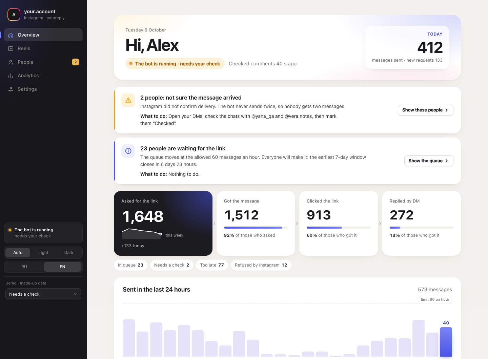
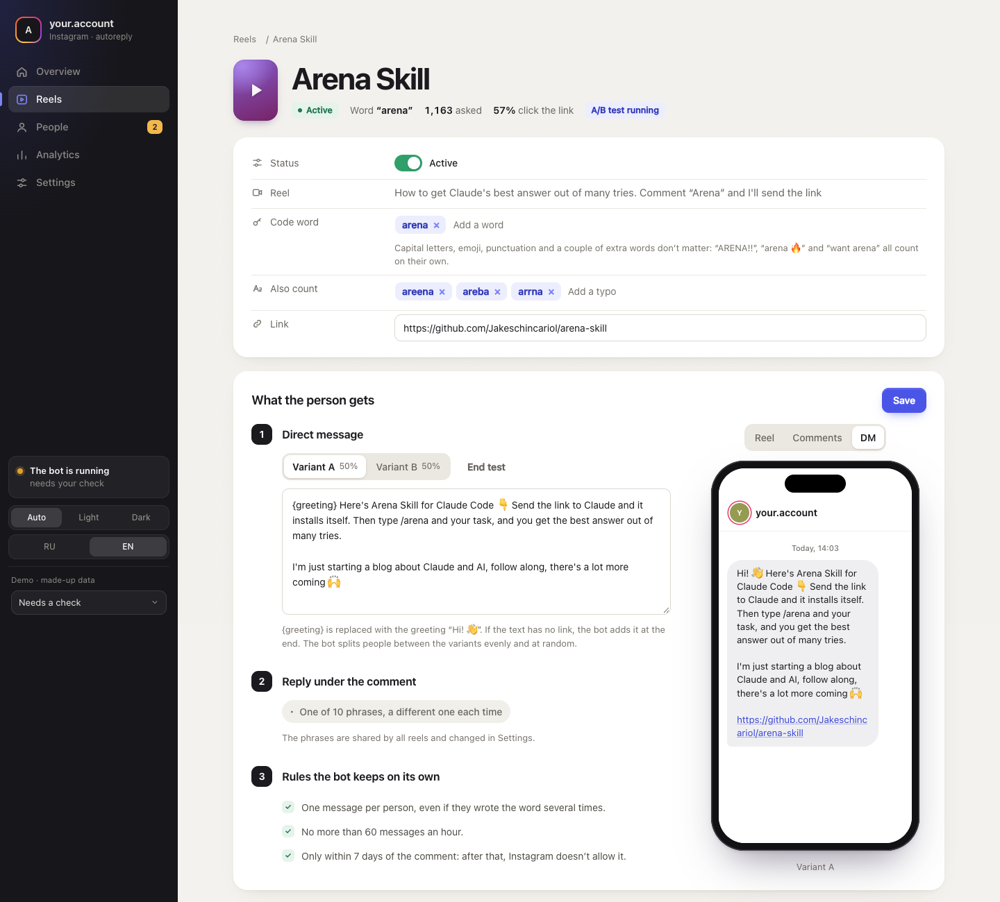
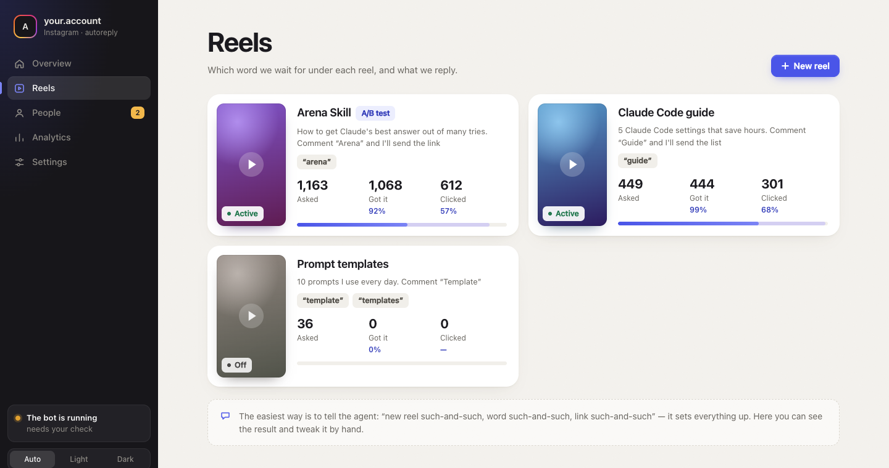
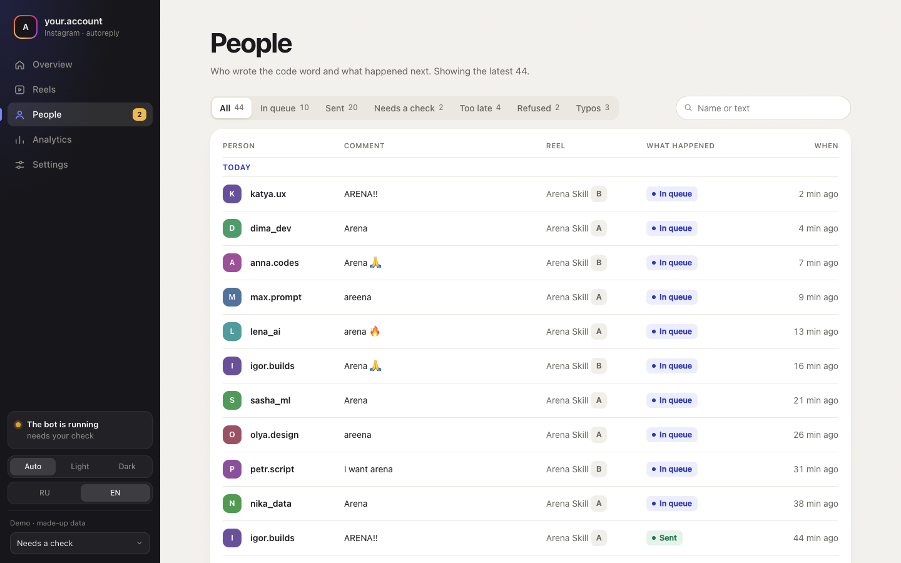
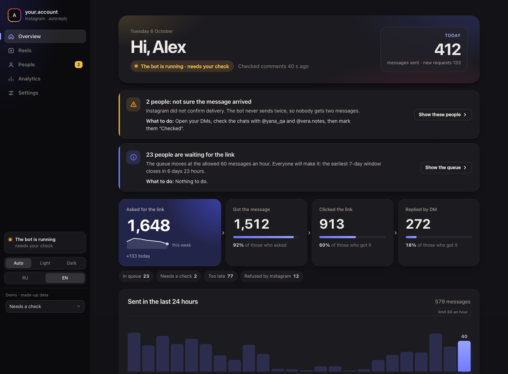
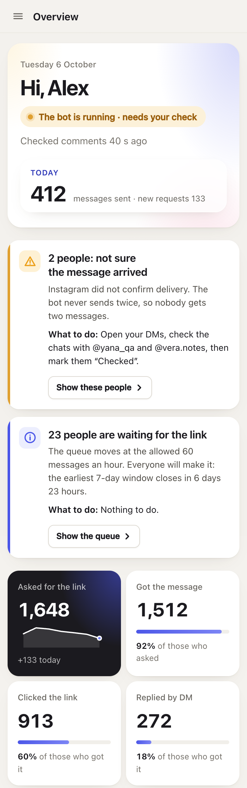
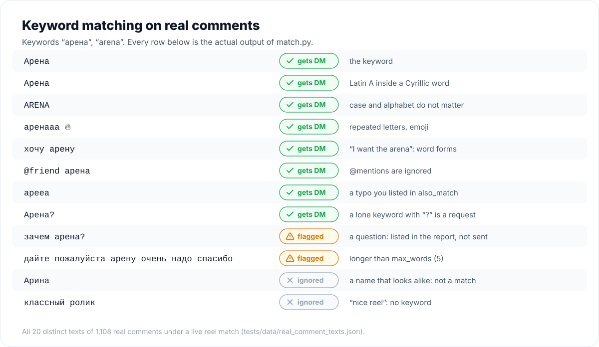
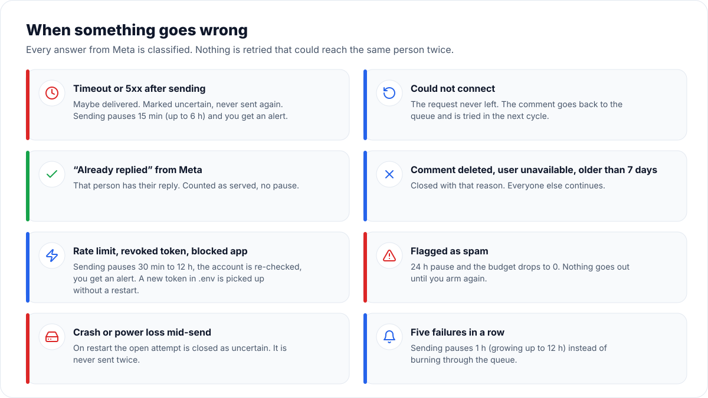

<p align="center"></p>

<p align="center">
  <a href="https://github.com/Lemelson/tinyreply/actions/workflows/tests.yml"></a>
  <a href="LICENSE"></a>
  
  
</p>

**tinyreply** is a self-hosted, ManyChat-style "comment a keyword, get the link in DM" bot for Instagram.
Someone comments `guide` under your reel, and a minute or two later they have a private message with your link and a
public "check your DMs" reply under their comment.

It is the opposite of the usual open-source ManyChat clone: not a platform for agencies, but **one small
program for one creator on one cheap server**. It uses only Meta's official Instagram API, and it was built
around a single promise: **nobody gets the DM twice, and nobody is silently skipped.**

**[▶ Try the panel live](https://lemelson.github.io/tinyreply/demo/?lang=en)**: invented data, nothing to install.

<p align="center"></p>

- [See it](#see-it)
- [Why tinyreply](#why-tinyreply)
- [How it works](#how-it-works)
- [Optional: button, follow check, A/B tests, clicks, panel](#optional-button-follow-check-ab-tests-clicks-panel)
- [Compared with the alternatives](#compared-with-the-alternatives)
- [Quick start](#quick-start)
- [Everyday commands](#everyday-commands)
- [What it does not do (yet)](#what-it-does-not-do-yet)
- [For AI agents](#for-ai-agents)
- [Keeping your secrets out of git](#keeping-your-secrets-out-of-git)

## See it

The web panel is optional. The bot runs fine without it, with the `report` command and Telegram alerts.
English and Russian, light and dark.

| | |
|---|---|
|  |  |
| **A reel:** keyword, accepted typos, link, the DM text with A/B variants, and a live phone preview. | **Reels:** what each reel answers to, and how many people asked, got the DM and clicked. |
|  |  |
| **People:** everyone who asked, grouped by day, with what happened and why. Click a row for the full story. | **Analytics:** the funnel, the last week, and the A/B test result in plain words. |
|  |  |
| **Dark theme**, following your system or chosen by hand. | **On a phone:** the same panel, one column. |

## Why tinyreply

| | |
|---|---|
| **Tiny** | One Python process, one thread, one SQLite file. **32 MB RAM** measured on a live Ubuntu server. About 3,900 lines of code. |
| **Zero dependencies** | Python 3.12 standard library only. No `pip install`, no Node, no Docker, no build step, nothing to keep patched. |
| **Zero open ports by default** | The core polls Meta instead of waiting for webhooks. No domain, no TLS certificate, no public URL to keep stable. Runs behind NAT or next to other services. The [optional web process](#optional-button-follow-check-ab-tests-clicks-panel) adds one HTTPS endpoint only if you want buttons, follow checks, click stats or the panel. |
| **Never double-sends** | Each DM is claimed in the database *before* the request leaves. A crash, a restart or a second copy of the bot cannot send it twice (a file lock stops the second copy). |
| **Never silently loses people** | Every matched comment ends in an explicit status with a reason. The report checks that the numbers add up (`unaccounted` must be 0). When people are waiting or being lost, you get a Telegram alert, and it repeats until the problem ends. |
| **Catches up** | It reads the whole 7-day window that Meta allows for private replies. If the bot was down for a day, the backlog is served, oldest first, within your hourly limit. |
| **Understands real comments** | `guide`, `GUIDE`, `Guide!!`, `guiiide 🔥`, `I want the guide`, `@friend guide`: all match the keyword `guide`. Case, punctuation, repeated letters, emoji, @mentions, look-alike letters from other alphabets (Latin and Cyrillic) and the typos you list are handled. It was tested on 1,108 real comments from a live reel: every one of them matched. |
| **Safe by default** | A new database, a config change or a code update sets the send budget to 0. Nothing goes out until you `arm` it. `disarm` is an instant emergency brake. |
| **Tested like it matters** | 848 unit tests, 299 simulator tests and named end-to-end scenarios run the real bot against a strict fake of the Meta API. The fake injects timeouts, 5xx errors, rate limits, token expiry, spam blocks and crashes in the middle of a send. |

## How it works

<p align="center"></p>

Every `poll_interval_sec` (90 s by default) the bot reads the comments of every active reel, matches them,
and sends at most `max_sends_per_hour` private replies. Meta allows **one** private reply per comment, within
7 days. If Meta's answer is ambiguous (a timeout after the request was sent, for example), the comment is marked
`uncertain`, the bot does **not** retry it, and you are told. A second DM to the same person is worse than one
missed DM that you can check by hand.

### What gets matched

<p align="center"></p>

Nothing is fuzzy-guessed. Typos you want to accept go into `also_match`. The report lists frequent short comments
that did not match, so you see which typos are worth adding.

### When something goes wrong

<p align="center"></p>

### One command shows everything

<p align="center"></p>

The bot prints this report in Russian today; the picture is a line-by-line translation of a real run against the
bundled fake Meta API. The web panel is available in English.

## Optional: button, follow check, A/B tests, clicks, panel

Everything above works with no inbound connections at all. If you also want the things ManyChat is known for,
run a second small process, `web.py` (Python standard library, `MemoryMax=60M`, listens on 127.0.0.1 behind
your nginx). It never calls Meta and never sends; it only stores what comes in, and the bot answers.

| Feature | What happens |
|---|---|
| **"Get it" button** | The first DM carries a button. The link is sent when the person taps it, which also opens a real conversation. |
| **Follow check** | After the tap the bot asks Instagram whether the person follows you. If not, it asks them to follow and tap "Done" (at most three times), then sends the link. If Instagram gives no clear answer, the link is sent anyway. |
| **Link buttons and a follow-up** | The link arrives with up to two buttons; an optional follow-up message ("Did it work?") goes out later, inside Meta's 24-hour window. |
| **A/B tests** | Up to four variants per reel, each with its own text, with or without the button and the follow check. A person always stays in the same variant. The panel shows each variant's funnel and says in plain words whether the difference is real or could be chance. |
| **Click tracking** | Links go through your own `/r/<token>` redirect. Instagram's link-preview robot is not counted as a click. No cookies and no IP addresses are stored. |
| **Web panel** | Everything above, plus queues, alerts and every person's story, behind a login at `/panel/`. Read-only: settings stay in `config.json`. |

Configuration: the `flow` block of a reel and `click_base`, in section 14 of [`autoreply/SPEC.md`](autoreply/SPEC.md).
Setup: [Run the web process](#run-the-web-process-optional).

> **Status: new.** The funnel is covered by unit tests and the panel runs on a live account, but buttons have
> not yet been sent to many people. One vendor reports that since late August 2026 Instagram refuses a button
> in a private reply to someone who does not follow you, and that refusal uses up the one allowed reply. It is
> unverified. Before turning the button on for everyone, test it with a second account that does not follow
> you, and compare variants with and without the button in the panel.

## Compared with the alternatives

<p align="center"></p>

<p align="center"></p>

The two most popular open-source projects in this niche, checked on 10 Nov 2026:

| | **tinyreply** | [OpenReply](https://github.com/diwenne/openreply) | [ChatbotX](https://github.com/ChatbotXIO/ChatbotX) | [chatmany](https://github.com/ryanlaiyanip-ctrl/chatmany) | ManyChat / ChatPlace (SaaS) |
|---|---|---|---|---|---|
| Runs on | any Linux box with Python 3.12 | Node ≥ 20 + Postgres + Redis + SMTP | ~10 services, TimescaleDB, S3 | Cloudflare Workers + D1 | their cloud |
| RAM | **32 MB** (measured) | ≈ 350–700 MB (estimate) | 2 GB documented minimum | — | — |
| Needs a public HTTPS endpoint | **no** (yes for the optional funnel) | yes | yes | no (Cloudflare) | no |
| Third-party dependencies | **0** | 14 runtime packages | 200+ across its apps | 0 runtime (Cloudflare) | — |
| Serves the 7-day backlog | **yes, all of it** | last 72 h, 30 per pass | manually, one post | last 50 comments | varies |
| Cyrillic/Latin + typo matching | **yes** | no | partial | no | no |
| Double-send protection | claim before send + unique key | claim before send + unique key | not checked | claim before send | n/a |
| Alerts when people are stuck | **Telegram, repeated** | no | no | no | in-app |
| Follow gate (“follow me first”) | optional, new | yes | build it yourself | no | yes |
| Link click tracking | optional, robots excluded | yes | no | no | yes |
| A/B testing of messages | up to 4 variants, funnel per variant | no | traffic splitter, no report | no | on some plans |
| Web dashboard | optional, read-only, EN/RU | yes | yes | yes | yes |
| Many accounts / team roles | no, one account | yes | yes | no | yes |
| Your data stays on your server | yes | yes | yes | your Cloudflare | no |
| Price | free, MIT | free, MIT | free, MIT + enterprise | free, MIT | monthly subscription |

The OpenReply and ChatbotX memory figures come from their documentation, their issue trackers and our
reading of their stacks. They are not benchmarks.

**Choose tinyreply** if you are one creator (or run a few accounts as separate installs), want the link
delivered reliably, and want something you can leave running on a $3 VPS for months.
**Choose OpenReply** if you need several team members, editing settings in the browser, or a battle-tested
follow gate today.
**Choose a SaaS** if you never want to touch a server or a Meta developer app.

## Quick start

You need:

1. An Instagram **professional** account (Creator or Business).
2. A Meta developer app with the product **Instagram API with Instagram Login** and the permissions
   `instagram_business_basic`, `instagram_business_manage_comments` and `instagram_business_manage_messages`.
   For your own account, which has a role in your own app, standard access is enough and App Review is not
   needed. Generate an access token for the account in the app dashboard.
3. Python **3.12+** on Linux or macOS.
4. Optional but recommended: a Telegram bot and chat for alerts.

```bash
git clone https://github.com/Lemelson/tinyreply.git
cd tinyreply/autoreply
mkdir -p state && chmod 700 state
cp ../.env.example state/.env && chmod 600 state/.env   # paste IG_ACCESS_TOKEN (and TG_* for alerts)
cp config.example.json state/config.json
```

Edit `state/config.json`. Set `profile_url` to your account, and set each reel's `media_id`, `keywords`,
`link` and `text`. Leave `"sending": false` for now.

```bash
python3 bot.py check --online   # validates config + .env, calls GET /me, sends one Telegram test
python3 bot.py once             # one cycle: reads comments, sends nothing (sending is off, budget is 0)
python3 bot.py media            # lists your recent posts with their media_id, to fill in config.json
python3 bot.py report           # who matched, who is waiting and why
```

When the report looks right, set `"sending": true`, then:

```bash
python3 bot.py arm 20           # allow up to 20 DMs; raise it once you trust the setup
python3 bot.py run              # the service loop (Ctrl+C stops it cleanly)
```

`arm` refuses to work while no alert channel is configured, because a bot that cannot tell you about problems
should not be sending. Use `arm N --deaf` to override that on purpose.

### Run it as a service

`deploy/ig-autoreply.service` is a hardened systemd unit (dedicated user, `MemoryMax=100M`, watchdog,
clean stop). `deploy/igbot` is a wrapper that runs commands as the service user with a clean environment.

From the repository root, with the `state/` you prepared above in `autoreply/state/`:

```bash
sudo useradd --system --home /opt/ig-autoreply igbot
sudo mkdir -p /opt/ig-autoreply/state && sudo cp autoreply/*.py autoreply/config.example.json /opt/ig-autoreply/
sudo cp autoreply/state/config.json autoreply/state/.env /opt/ig-autoreply/state/ && sudo chown -R igbot:igbot /opt/ig-autoreply/state
sudo chmod 700 /opt/ig-autoreply/state && sudo chmod 600 /opt/ig-autoreply/state/.env
sudo cp deploy/ig-autoreply.service /etc/systemd/system/ && sudo install -m 755 deploy/igbot /usr/local/bin/igbot
sudo systemctl daemon-reload && sudo systemctl enable --now ig-autoreply
igbot report
```

### Run the web process (optional)

Needed only for the button, the follow check, click tracking and the panel. You need a domain pointing at the
server and nginx with a certificate.

1. In `state/.env` set `IG_APP_SECRET`, `WEBHOOK_VERIFY_TOKEN`, `PANEL_USER` and `PANEL_PASSWORD`
   (see [`.env.example`](.env.example)).
2. Install the panel files and the unit:
   ```bash
   sudo cp autoreply/web.py autoreply/panel.py /opt/ig-autoreply/
   sudo mkdir -p /opt/ig-autoreply/dashboard && sudo cp -R dashboard/index.html dashboard/assets dashboard/data /opt/ig-autoreply/dashboard/
   sudo cp deploy/ig-autoreply-web.service /etc/systemd/system/ && sudo systemctl daemon-reload
   sudo systemctl enable --now ig-autoreply-web
   ```
3. Copy [`deploy/nginx-example.conf`](deploy/nginx-example.conf), put in your domain, and reload nginx.
4. In your Meta app, add the webhook `https://your-domain/meta/webhook` with the same verify token and subscribe
   to `messages` and `messaging_postbacks`.
5. In `config.json` set `"click_base": "https://your-domain/r/"` and add a `flow` block to a reel (SPEC 14.2).
6. Open `https://your-domain/panel/` and log in.

## Everyday commands

| Command | What it does |
|---|---|
| `report` | State, problems, per-reel queues, hourly sends, near-misses and frequent typos. Read-only. |
| `check [--online]` | Validates `config.json` and `.env`; `--online` also calls Meta and Telegram. |
| `arm N` / `disarm` | Sets the send budget to N / to 0 (the emergency brake). Takes effect at the next send. |
| `media` | Recent posts with `media_id`, permalink and comment count. |
| `once` | Runs one cycle and exits. |
| `send-one COMMENT_ID` | One cycle that may DM only this comment. |
| `ack-uncertain COMMENT_ID` | "I checked this one by hand." Marks it only and never resends. |
| `run` | The service loop. |

Configuration reference, guarantees and every edge case: [`autoreply/SPEC.md`](autoreply/SPEC.md).

## What it does not do (yet)

- **Edit settings in the browser.** The panel is read-only on purpose; settings live in `config.json`, and a
  coding agent can change them for you.
- **Answer DM keywords and story replies.** An incoming message is stored, not answered.
- **English alerts and report.** Your DM texts are yours, in any language, and the panel speaks English, but
  Telegram alerts and the CLI `report` are in Russian. Pull requests for i18n are welcome.
- **Battle-tested buttons.** See the status note in [the optional funnel](#optional-button-follow-check-ab-tests-clicks-panel).
- **One account per install.** Run several installs with separate `STATE_DIR`s for several accounts.

## For AI agents

tinyreply is designed to be operated by a coding agent (Claude Code, Codex, Cursor) on behalf of a
non-technical creator: "add a reel with the keyword *guide* and this link". See **[AGENTS.md](AGENTS.md)**
for the rules: what to edit, what never to touch, how to verify a change, and how to arm safely.

## Keeping your secrets out of git

Everything that belongs to one installation lives in `STATE_DIR` (`state/` by default). That covers the
tokens (`.env`), the settings (`config.json`) and the database. `.gitignore` excludes all of it. The bot never
reads secrets from the process environment, only from `STATE_DIR/.env`.

As a second line of defence, enable the pre-commit hook once per clone:

```bash
git config core.hooksPath .githooks
```

It runs [`scripts/leak-scan.sh`](scripts/leak-scan.sh) and refuses a commit that contains a `.env`, a real
`config.json`, a database, a private key or anything that looks like an Instagram, Facebook, Telegram,
GitHub or LLM API token. It also uses `gitleaks` when it is installed. To protect personal strings such as your
handle, your server's IP or your phone number, put them one per line in `~/.config/tinyreply/denylist.txt`.
That file is outside the repo and is never committed.

## Running the tests

```bash
cd autoreply
python3 -m unittest discover -s tests -t .     # 848 tests, ~2 min
python3 -m unittest discover -s sim -t .       # 299 tests against the fake Meta
python3 sim/soak.py --only named               # named end-to-end scenarios
python3 sim/soak.py --seeds 30 --start 100     # randomized fault-injection runs
```

## Credits

Diagram logos from [Simple Icons](https://simpleicons.org) (CC0) and icons from [Lucide](https://lucide.dev) (ISC); see `docs/icons/NOTICE.md`. Regenerate the diagrams with `python3 docs/make_images.py`.

## License

MIT. Not affiliated with Meta, Instagram, ManyChat or ChatPlace. Use the official API within Meta's
Platform Terms, and only message people who asked for it by commenting.
